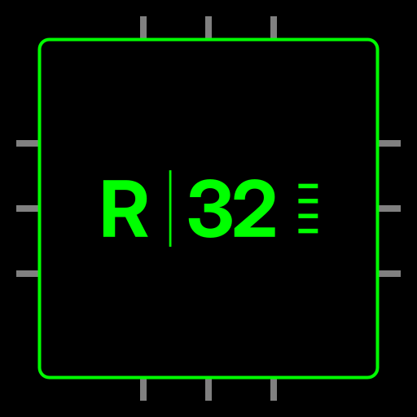

<div align="center">
  
</div>

# R-32 CPU
An open-source 8-bit CPU with its own ISA, VM, and assembler.
## Overview

The R-32 is a complete 8-bit computer architecture designed from scratch. It includes a frozen Instruction Set Architecture (ISA), a Python-based Virtual Machine (VM), and a two-pass assembler with label resolution.

## Features

- **16 Registers**: R0 (hardwired to 0), R13 (Stack Pointer), R14 (Link Register).
- **24 Opcodes**: Full ALU, memory operations, and control flow.
- **4-byte instructions**: [opcode][rd][rs][imm8] (Little-endian).
- **Hardware Stack**: Managed stack with PUSH and POP.
- **Flags**: Zero (Z), Negative (N), Carry (C), Overflow (V).

## Register File

- **R0** (ZERO): Hardwired to 0. Writes are ignored.
- **R1** (RA): Return Address.
- **R2** (A0): Argument 0.
- **R3** (A1): Argument 1.
- **R4-R6** (T0-T2): Temporaries (Caller-saved).
- **R7-R11** (S0-S4): Saved Registers (Callee-saved).
- **R12** (FP): Frame Pointer.
- **R13** (SP): Stack Pointer (Grows downwards).
- **R14** (LR): Link Register (For CALL).
- **R15** (GP): Global Pointer (Reserved).

## Instruction Set

- **0x00 HALT**: Stops execution.
- **0x01 PRINT**: Prints a register (Pedagogical).
- **0x02 MOV**: Loads immediate value.
- **0x03 ADD**: Rd = Rd + Rs.
- **0x04 SUB**: Rd = Rd - Rs.
- **0x05 CMP**: Compares Ra and Rb.
- **0x06 JZ**: Jump if Zero.
- **0x07 JMP**: Unconditional jump.
- **0x08 LOAD**: Rd = mem[addr8].
- **0x09 STORE**: mem[addr8] = Rd.
- **0x0A NOP**: No operation.
- **0x0B AND**: Bitwise AND.
- **0x0C OR**: Bitwise OR.
- **0x0D XOR**: Bitwise XOR.
- **0x0E SHL**: Shift Left.
- **0x0F SHR**: Shift Right.
- **0x10 JNZ**: Jump if Not Zero.
- **0x11 JN**: Jump if Negative.
- **0x12 PUSH**: Push to stack.
- **0x13 POP**: Pop from stack.
- **0x14 CALL**: Call subroutine.
- **0x15 RET**: Return from subroutine.
- **0x16 INC**: Rd = Rd + 1.
- **0x17 DEC**: Rd = Rd - 1.

## Project Structure

- `isa.py`: The frozen Instruction Set Architecture.
- `src/vm.py`: The Virtual Machine.
- `src/assembler.py`: Two-pass assembler.
- `src/memory.py`: Memory manager.
- `src/main.py`: The full pipeline.
- `examples/`: Assembly programs.
- `docs/`: Design choices and logo.

## Getting Started

Requires Python 3.10 or higher. No external dependencies.

```bash
git clone https://github.com/HvKOkla/R-32-CPU.git
cd R-32-CPU
```

Choose a program in `src/main.py`:
```python
nom_test = "fibonacci"
```

Run:
```bash
python src/main.py
```

## Example Programs

- `test_all.r32`: Global test suite.
- `fibonacci.r32`: First 10 terms of Fibonacci.
- `bubble_sort.r32`: Sorts 4 numbers.
- `eratosthenes.r32`: Sieve of Eratosthenes.
- `guess.r32`: Number-guessing game.

## Roadmap

- [x] Design the ISA (v1.0).
- [x] Implement the Python VM and Assembler.
- [x] Write example programs.
- [ ] Port the CPU to Amaranth HDL (Python).
- [ ] Synthesize on Tang Nano 9K FPGA.

## License

This project is licensed under the MIT License - see the [LICENSE](LICENSE) file for details.
```
